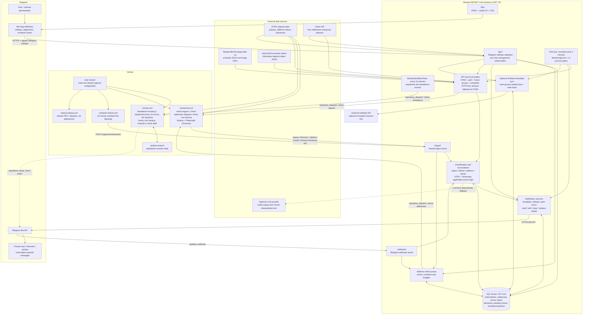

# Application architecture

Onboarding reference, based on the working tree on 21 October 2026. This describes
implemented code, including local changes; it is not confirmation that every
feature is deployed. Hosting is an ASP.NET Core application with SQL Server;
IIS/Web Deploy is supported, but the current server configuration was not audited.

The Mermaid diagram below reflects API-hosted popup interpretation. The
[older SVG snapshot](architecture.svg) predates that change.

## 1. The big picture

There are **two execution modes** in this repository:

1. **Shared application (main product):** one .NET backend serves many Telegram
   subscriptions. It owns settings, source reconciliation, delivery history and
   the Mini App.
2. **Standalone monitor (optional/legacy):** a Node.js script can post directly to
   one configured Telegram chat. It does not use the shared backend's subscription
   database. Do not confuse its GitHub `artifacts` state with the backend database.

Solid arrows show implemented calls or data flow; the dashed LLM/direct-post
arrows are optional paths. Not every ingest endpoint performs every operation:
the diagram groups the API boundary for readability.

## 2. Runtime ownership and cadence

| Component | Responsibility | Trigger / persistence |
|---|---|---|
| Backend `TickLoop` | Collect DTEK popups, grid status and Yasno group status alongside cache-aware schedule reads; reconcile after collection; evaluate schedule messages and Svitlobot | Default 5 minutes, after an initial 30-second delay; configurable / disableable |
| Baskerville schedule provider | Share one snapshot per source file across cycles, Mini App reads and backup schedule ticks; conditional GET when due; retain usable stale data on failure | 10-minute refresh window (`Dtek:Schedules:CacheMinutes`); intervening 5-minute cycles use cached data, including backoff after failed attempts |
| Backend `MonitorWorkflowTimer` | Dispatch `check-emergency` to the standalone monitor workflow, because GitHub cron often skips runs | Every `Dtek:Timers:MonitorWorkflowIntervalMinutes` in `dtek-settings.json` (default 15, `0` = off); needs `GitHub:Repository` and `GitHub:DispatchToken` |
| GitHub monitor workflow | Optional standalone monitor (`monitor.js`) | Backend dispatch every 15 minutes; hourly UTC cron backup at minute 7; manual, `check-dtek` (with address check) and `check-emergency` |
| GitHub shared-bot workflow | Browser observations, address directories and queued checks; asks the API to run a coordinated monitoring tick as backup | `check-regions` / `check-addresses` dispatch from the backend; hourly UTC cron backup at minute 37; manual |
| GitHub schedule-refresh workflow | Ask backend to evaluate schedules and sync Svitlobot (backup for `TickLoop`) | UTC cron every 10 minutes, offset to minute 2 |
| SQL Server | Shared product's durable state | EF Core; source state, subscriptions and delivery records survive restarts |
| Backend memory | Source/model caches, coordination gates and pending correlated browser replies | Process lifetime only; not a distributed queue/lock; popup results cached up to 24 hours with 30-minute provider-failure cooldown |
| GitHub `artifacts` branch | Standalone monitor state | Monitor workflow writes it |
| Release workflow | Release PR / GitHub release management | Push to `main`; **not a backend deployment pipeline** |

GitHub cron is best-effort, not a real-time scheduler. The built-in timer requires
the backend process to stay alive (important with IIS). Both timer paths can
evaluate the same schedule: stored delivery fingerprints and gates prevent
duplicate work/messages within the application instance.
The personal monitor first dispatches after 60 seconds; failed dispatches retry
on the next interval. Dispatch acceptance is not proof of a completed run.
Deploy the backend and merge workflows to the default branch to activate them.
Use one backend instance; the timers and coordination gates are not distributed.

Shared-bot group collection and popup interpretation are API-owned services.
Browser workers supply raw source observations; the independent standalone
private-channel monitor/parser remains unchanged. Legacy group ingest accepts
optional `observedAt` for ordering, but untimestamped legacy callers cannot provide
the same out-of-order protection.

Accepted emergency records remain persisted when a source becomes unavailable.
Some reconciliation and assessment paths still use those records without an
evidence-age expiry; this known release gap is separate from rejecting stale or
out-of-order incoming observations. No automatic clearance is inferred from age.

## 3. Main journeys

### Regional emergency and stabilization

1. The backend tries direct HTTP collection of configured DTEK sites. Invalid or
   blocked pages are not interpreted as "no emergency."
2. Failed regions can trigger a GitHub browser run using `repository_dispatch`.
   A collection ID correlates callbacks to the waiting runtime cycle.
3. The API interprets both direct and browser observations LLM first using a forced
   settings-driven tool. Deterministic clause-aware parsing handles unavailable
   providers and unusable results. Parsed district states, unable-to-parse, and
   no-information are distinct; a nonempty unknown notice remains a region-wide
   Unknown alert. There is no LLM in message rendering or schedule diffing.
4. The backend stores observations and combines applicable DTEK, Ukrenergo and
   local group evidence. Routing respects city versus oblast, selected districts
   and subscription targets in every configured region; mixed notices can assign
   Emergency to one district and Stabilization to another. An unrelated district notice does not suppress an
   applicable broader source.
5. Notification services render each chat's templates and posting mode, then
   store delivery state. Affirmative stabilization and a disappearing popup are
   different transitions; neither proves that electricity is physically on.

### Settings and read-only schedules

1. Telegram opens the backend-hosted Mini App with signed `initData`.
2. The Mini App sends `Authorization: tma ...` to `/api/*`; the backend validates
   it and checks management access for protected chat operations.
3. Saving persists per-chat settings, addresses/groups, templates and posting
   preferences. A subscription supports up to three addresses in one region.
4. The read-only viewer uses `/api/schedules/groups` and `/api/schedules/view`.
   It does not need a linked channel and does not save settings or publish posts;
   Telegram Mini App authentication is still required.
5. Diagnostics distinguish saved settings, cached/absent source data and delivery
   records. Schedule countdowns represent the **published plan**, not measured power.

### Address check

1. A personal check request, or an enabled channel-post trigger, starts an
   assessment using available schedule/regional evidence.
2. If a website check is needed, the backend saves a pending request with cache,
   cooldown, budget and batching controls.
3. GitHub dispatch wakes the browser worker. It reads pending work from the
   backend, checks DTEK, and returns results through secret-protected ingest.
4. The backend stores the answer and posts the appropriate response. Scheduled
   monitor runs can also drain pending work if an immediate dispatch fails.

### New or changed schedule

1. A backend or GitHub tick reads the shared cached schedule provider.
2. The notifier compares each eligible subscription's date/group plan with its
   saved delivered baseline; missing group/day coverage is **unavailable**, not
   an empty plan.
3. Changed plans are posted/edited/replaced using saved templates; deterministic
   added/removed-interval summaries are available.
4. Successful delivery advances the baseline. Unchanged content is deduplicated.
5. If connected, the Svitlobot service pushes the chat's main group week
   (published daily schedules where available, the weekly preset elsewhere)
   with fingerprint checks, write limiting and a Monday refresh.

## 4. Boundaries and operational facts

- **Production database:** SQL Server. Test fixtures use isolated SQLite; do not
  design production operations around the test database.
- **Mini App:** the active UI is plain JavaScript in `wwwroot/lite`, served by the
  same backend. The repository also contains a Blazor WebAssembly project, but it
  is not the configured primary Telegram Mini App.
- **Secrets:** bot token, webhook secret, ingest secret, GitHub dispatch token,
  database connection and optional model key belong in configuration/secrets,
  never diagrams or source. Svitlobot keys are encrypted at rest.
- **Source availability:** local Yasno group-status ingest is configured for
  Kyiv only. Other regional schedule availability depends on the external feed.
- **Actual power:** popups, address records and planned schedules do not measure
  voltage. Sensor/monitor messages are a separate input, not proof inferred from
  an empty website result.
- **Scaling:** gates and pending callback correlations are process-local.
  Multi-instance operation would require deliberate shared coordination; the
  repository does not provide a distributed message broker.
- **Hosting:** `/health` is a simple liveness endpoint, not a full source,
  database or Telegram readiness probe.
- **Tests:** deterministic unit/API tests, mocked browser regressions and opt-in
  live Telegram/browser-to-backend tests exist. A live Telegram transport test
  does not prove production cron, hosting or mobile Telegram authentication.

## 5. First files to read

| Area | Entry points |
|---|---|
| Composition, middleware, webhook and popup ingest | [Program.cs](../bot/src/DtekBot.Api/Program.cs) |
| Timers and parallel source collection | [TickLoop.cs](../bot/src/DtekBot.Api/Bot/TickLoop.cs), [MonitoringCycle.cs](../bot/src/DtekBot.Api/Bot/MonitoringCycle.cs) |
| Browser fallback | [DtekPopupCollector.cs](../bot/src/DtekBot.Api/Parsing/DtekPopupCollector.cs), [ingest-regions.js](../src/ingest-regions.js) |
| Geographic/source reconciliation and sends | [RegionAlertCoordinator.cs](../bot/src/DtekBot.Api/Bot/RegionAlertCoordinator.cs), [AlertDispatcher.cs](../bot/src/DtekBot.Api/Bot/AlertDispatcher.cs) |
| Mini App and authenticated API | [app.js](../bot/src/DtekBot.Api/wwwroot/lite/app.js), [MiniAppApi.cs](../bot/src/DtekBot.Api/MiniApp/MiniAppApi.cs) |
| Durable data model | [BotDbContext.cs](../bot/src/DtekBot.Api/Data/BotDbContext.cs) |
| Schedule parsing, notification and Svitlobot | [Schedules/](../bot/src/DtekBot.Api/Schedules/), [Svitlobot/](../bot/src/DtekBot.Api/Svitlobot/) |
| Worker schedules | [monitor.yml](../.github/workflows/monitor.yml), [shared-bot.yml](../.github/workflows/shared-bot.yml), [schedule-refresh.yml](../.github/workflows/schedule-refresh.yml), [MonitorWorkflowTimer.cs](../bot/src/DtekBot.Api/Checks/MonitorWorkflowTimer.cs) |
| Regional/operator configuration | [dtek-settings.json](../bot/src/DtekBot.Api/dtek-settings.json) |
| Tests | [DtekBot.Tests/](../bot/tests/DtekBot.Tests/), [lite-editor.test.js](../src/lite-editor.test.js), [live-ui-check.js](../src/live-ui-check.js) |
